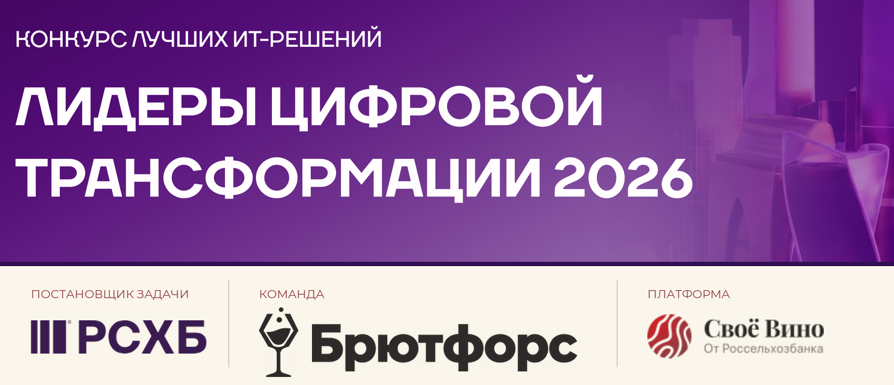
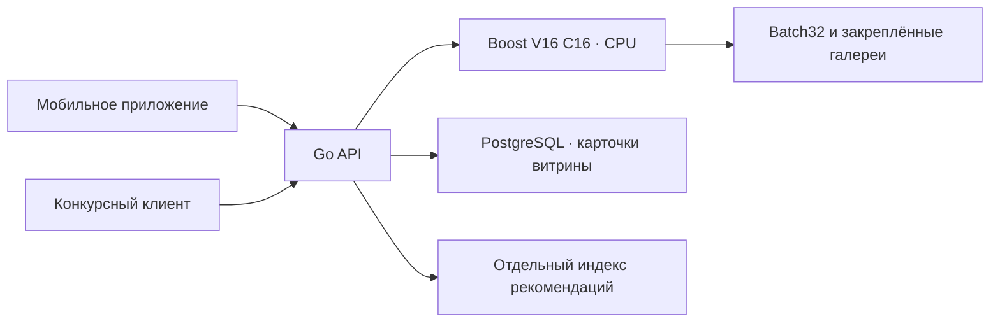
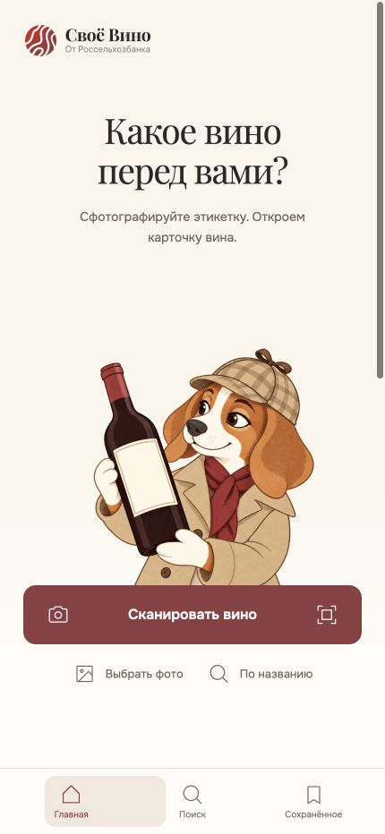
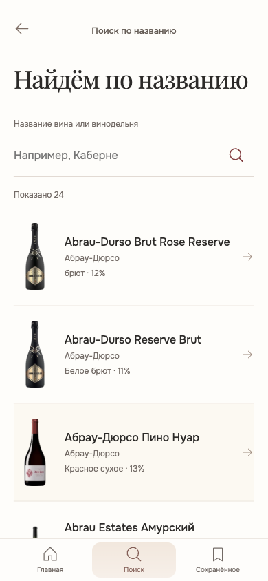
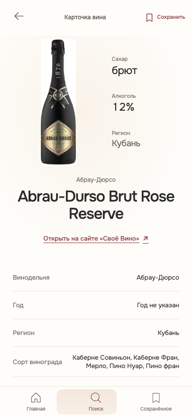

# BrutForce — сканер российских вин

<p align="center">
  
</p>

BrutForce — проект команды соревнования **«Лидеры цифровой трансформации — 2026»** по кейсу **Россельхозбанка (РСХБ)** для платформы «Своё Вино». Задача — найти точную запись в каталоге российских вин по фото этикетки и открыть её карточку на телефоне. Для этого работают распознавание изображения, каталог и мобильное веб-приложение. Если подтверждённой карточки нет, приложение сообщает об этом и оставляет результат без подмены.

[Сайт проекта](https://brutforce.dzap.pw/) · [Демо приложение](https://app.dzap.pw/)

Для двух способов поиска предусмотрены разные API:

- **Проверка организаторов:** [`POST /v1/eval/predict`](https://app.dzap.pw/v1/eval/predict) получает фото в поле `image` и при совпадении возвращает `slug`.
- **Поиск в приложении:** [`POST /v1/photos`](https://app.dzap.pw/v1/photos) получает фото в поле `photo`, затем [`POST /v1/search`](https://app.dzap.pw/v1/search) принимает `photoId` и возвращает кандидатов для интерфейса.

Пример запроса для организаторов приведён ниже.

**Авторы проекта:** Максим Попков ([Telegram @skifmax](https://t.me/skifmax)) и Роман Карандашов ([GitHub MisterMolox](https://github.com/MisterMolox)). [English](README.en.md).

## Боевая версия

На 31 октября 2026 на [app.dzap.pw](https://app.dzap.pw/) работает **Boost V16 C16**:
дообученный **SigLIP2 SO400M Batch32**, RT-DETR, визуальные галереи и проверка
связанных OCR-свидетельств. Это CPU-решение. Код действующего сервера перенесён
в этот репозиторий и сверен по SHA-256.

- [Точный состав прода и воспроизведение](docs/PRODUCTION.ru.md).
- [Манифест кода, весов, индексов и зависимостей](deploy/production.json).
- [Исходники C16](apps/vision/c16/README.md), [retrieval](apps/vision/boost/),
  [модельные primitives](apps/vision/parent/), [Go API](apps/api/README.md).

Старые F8/A2, `release.json` и прежний журнал выкаток не отражают всю текущую
боевую связку. Проверенное состояние установлено по работающим процессам,
их конфигурации, исходникам и контрольным суммам данных.

## Быстрый запуск

```sh
git clone https://github.com/ai-babai/brutforce.git
cd brutforce
python3 scripts/production-vision.py
```

Последняя команда только проверяет исходники. Она не скачивает веса и не
запускает сервис. Для распознавания нужен **внешний C16-комплект**: точные
43 файла и SHA перечислены в `deploy/production.json`.
Старый F8-комплект с Яндекс Диска не заменяет эти данные.

На Linux с Python 3.12 и версиями из
[`production-requirements.txt`](deploy/assets/production-requirements.txt):

```sh
python3.12 scripts/production-vision.py --data-root /absolute/path/to/c16-data
python3.12 scripts/production-vision.py --data-root /absolute/path/to/c16-data \
  --runtime /absolute/path/to/new-private-runtime --serve
```

Модель слушает `127.0.0.1:8137`. [Структура данных, Go API и ограничения
нового запуска](docs/PRODUCTION.ru.md#внешние-данные-и-запуск).
Веса и пользовательские данные находятся вне Git.

Для просмотра интерфейса с синтетическим каталогом, без распознавания:

```sh
docker compose -f deploy/compose.demo.yaml up --build -d --wait
```

Старые `bootstrap-mac.sh`, `bootstrap-docker.sh` и полный `compose.yaml`
сохранены как **исторический F8-профиль**. Они не воспроизводят текущий C16.

## Как вызвать конкурсный API

```sh
curl --fail-with-body --max-time 10 \
  -F 'image=@/path/to/your-label.jpg' \
  https://app.dzap.pw/v1/eval/predict
```

- Совпадение: HTTP 200, `{"slug":"catalog-slug"}`.
- Подтверждённого совпадения нет: HTTP 200 с `action`, без `slug`.
- Техническая ошибка: другой HTTP-статус.

[Контракт](contracts/eval-predict.md), [оригинальный клиент организаторов](scripts/participant_test.sh).
Приложение использует другой путь: `POST /v1/photos` (поле `photo`) сохраняет
приватный снимок; затем `POST /v1/search` получает `photoId`.
Поиск по названию — `GET /v2/catalog?q=...`.

## Модель распознавания

1. **Визуальные кандидаты.** Batch32 SO400M строит признаки целого фото.
   При неоднозначности SIMPLE84 использует RT-DETR и дополнительные области
   бутылки. Результат ищется в закреплённых галереях по косинусной близости.
2. **Уточнение C16.** Связанные с изображением признаки этикетки, надписей,
   сорта, цвета и сахара проверяются отдельными ограниченными ветвями.
   OCR не генерирует карточку и не подменяет неизвестные свойства догадками.
   Уточнение сохраняет исходную область Top20; ошибочные или неполные
   свидетельства не дают права произвольно менять вино.
3. **API.** Go проверяет версии и допустимость slug по organizer allowlist.
   Для приложения он отдельно разрешает slug в существующую карточку витрины.

Модель и inference работают на одном основном потоке: Torch 2 / ORT 6,
очередь не более двух запросов. Точные правила находятся в неизменном
[коде C16](apps/vision/c16/), а не в старой схеме F8.
Checkpoint: `b82d343499bb1c6be6c5d84de321b9f2ca658caf844787003a5f57b5592e3178`.

## Краткая архитектура



Каталог распознавания и каталог витрины различаются. Если распознанное вино
отсутствует в витрине, приложение отвечает `outside_display_catalog`.
Рекомендации — отдельные похожие карточки, а не доказательство распознавания.
[Архитектура и границы](ARCHITECTURE.md).

## Интерфейс

<p align="center">
  
  
  
</p>

Исходники интерфейса и исправление индикатора сканирования включены в Git.
Пересобранный JS побайтово совпал с обслуживаемым продом при сверке 31.10.2026.

## Документация и история

- [Текущий прод, проверка и ограничения](docs/PRODUCTION.ru.md).
- [Карта проекта](MAP.md), [контракты](contracts/README.md), [документация](docs/README.md).
- [Исследования Романа](https://reps.roman.dzap.pw/#experiments),
  [UX-атлас](https://reps.maks.dzap.pw/view#references),
  [исторические проверки поведения](https://reps.maks.dzap.pw/behavior/).
- [Сентябрьские результаты](docs/SOLUTION.md) и [прежний F8 self-host](docs/SELF-HOST.ru.md)
  сохранены как история. Их измерения не выдаются за новую оценку C16.

Репозиторий открыт для чтения. Отдельная лицензия на повторное использование
кода не утверждена; публичность репозитория не означает права распространять
сторонние веса, каталог и фотографии. Новая независимая оценка качества
и проверка запуска C16 на другой машине при синхронизации не выполнялись.
